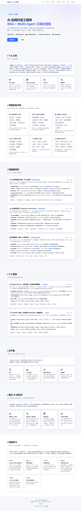
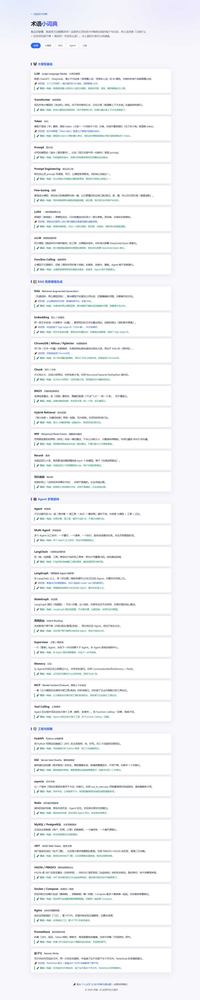

# 个人主页 · 乔晓

AI 应用开发工程师（RAG × Multi-Agent）的个人静态主页，纯 HTML/CSS/JS 单文件实现，零依赖、零构建，任意静态服务器可直接托管。

## 📄 页面一览

| 页面 | 文件 | 内容 |
|---|---|---|
| 主页 | `index.html` | 个人介绍、技术栈、目前项目、个人项目、关于我、我与 AI 的协作、持续学习 |
| 术语小词典 | `glossary.html` | AI/RAG/Agent 相关术语的通俗解释，按分类整理 |
| 技术详解与面试高频题 | `tech-guide.html` | 核心技术点详解与面试高频问答 |

## 📸 预览

| 主页 | 术语小词典 | 技术详解 |
|---|---|---|
|  |  |  |

## ✨ 特性

- **单文件架构**：三个页面各自独立，内联全部 CSS/JS，无外部依赖
- **浅色科技蓝主题**，响应式布局，移动端适配
- **滚动渐入动画**，并遵循 `prefers-reduced-motion` 尊重系统减动效设置
- **零构建部署**：`git clone` 后双击 `index.html` 即可打开

## 🚀 本地运行

无需安装任何依赖：

```bash
# 方式一：直接打开
start index.html

# 方式二：起个静态服务
python -m http.server 8080
# 访问 http://localhost:8080
```

## 📁 目录结构

```
├── index.html          # 主页
├── glossary.html       # 术语小词典
├── tech-guide.html     # 技术详解与面试高频题
└── docs/screenshots/   # README 预览图
```

---

© 2026 乔晓 · 联系方式见主页
